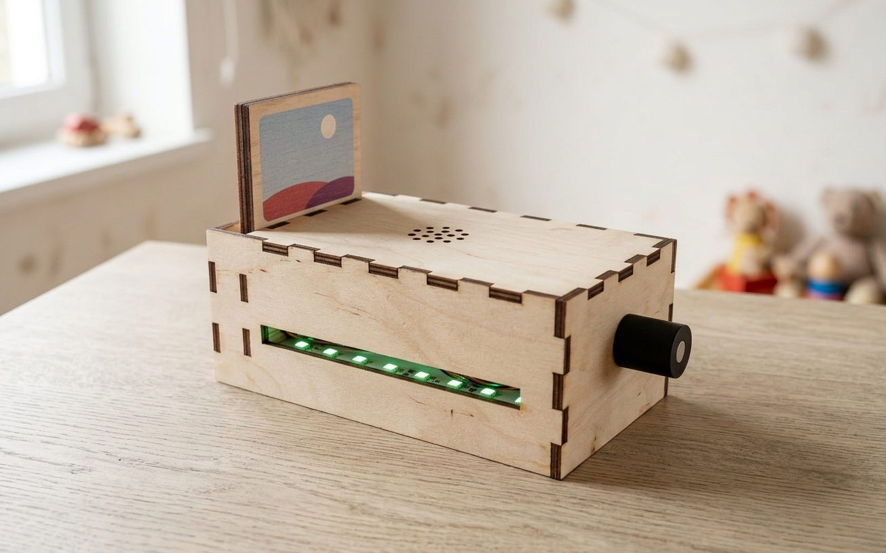

<p align="center"></p>

# TotoBox

[](https://github.com/thomas-lamure/totobox/actions/workflows/ci.yml)
[](LICENSES/GPL-3.0-or-later.txt)
[](LICENSES/CC-BY-SA-4.0.txt)

*[Version française](README.md)*

A do-it-yourself story and music box for young children: the child slides a card into the box and the story starts; pull the card out, it stops, and it resumes at the same spot next time. No screen, no account, no cloud: everything plays from a microSD card, and LEDs show what the box is doing.

<p align="center">
  
</p>
<p align="center"><em>AI-generated illustration based on a render of the 3D model (finger-joint version), until photos of real builds are available.</em></p>

This repository holds the firmware (ESP32-S3, HermitX CardReader board), the parents' web settings page, and the 3 mm plywood enclosure (Onshape models, laser-cut files and printable 1:1 templates).

**The project is written in French**: code comments, documentation, web interface and LED/serial messages. This page is the English entry point; the detailed guides are in French and translate well with any browser translator.

## Features

- **NFC cards**: one file or a whole folder per card, a bookmark per card (track and exact position), immediate stop when the card is removed.
- **Rotary knob** for volume, within limits set by the parents; **LEDs** for status (ready, playing, unknown card, error, volume).
- **Phone-friendly web page**: assign cards, upload and organise files, set Wi-Fi and limits. First-run wizard, captive portal when the box runs its own access point.
- **Parental lock**: master cards and a PIN, enforced by the firmware itself.
- **Standalone and offline**: Wi-Fi is only needed for settings; deep sleep after 5 minutes, wakes up when a card is inserted.
- **Updates from the page**: a new published version is announced and installs in one tap; the box downloads and verifies it itself.
- **Robust**: SD card hot removal, exFAT cards detected and formattable on the box, secrets encrypted between page and box, protection against requests from other websites.

## Building one

1. **Parts**: a HermitX CardReader board (ships with NFC antenna and speaker), a KY-040 rotary encoder, a microSD card, NFC tags, 3 mm plywood, M2 standoffs and screws. Full list: [hardware/README.md](hardware/README.md#nomenclature).
2. **Enclosure**: laser cut (finger-joint version) or hand sawn with a 1:1 printed template (hand-made version). Files in [hardware/laser/](hardware/laser).
3. **Wiring**: only the encoder needs wiring, see [hardware/electronics.md](hardware/electronics.md) (CLK → IO9, DT → IO10, SW → IO11, + → **3V3, never 5V**, GND → GND).
4. **Firmware**: with [PlatformIO](https://platformio.org/), board plugged in over USB-C:

   ```bash
   pio run -t upload      # firmware
   pio run -t uploadfs    # web interface
   ```

   Without PlatformIO: write the `totobox-X.Y.Z-complet.bin` image of the [latest release](https://github.com/thomas-lamure/totobox/releases/latest) at 0x0, with `esptool.py` or from the browser ([esptool-js](https://espressif.github.io/esptool-js/)). Each release's notes also explain how to update while keeping the settings.

5. **First start**: format the microSD card as FAT32, then join the `TotoBox-XXXX` Wi-Fi access point with a phone; the settings page opens by itself. See [docs/usage.md](docs/usage.md).

## Documentation (in French)

| Topic | File |
|---|---|
| Using and configuring the box | [docs/usage.md](docs/usage.md) |
| Building the enclosure, wiring | [hardware/README.md](hardware/README.md), [hardware/electronics.md](hardware/electronics.md) |
| Editing the 3D model | [hardware/onshape/README.md](hardware/onshape/README.md) |
| Building, testing, contributing | [docs/development.md](docs/development.md), [CONTRIBUTING.md](CONTRIBUTING.md) |
| Firmware internals | [docs/architecture.md](docs/architecture.md), [AGENTS.md](AGENTS.md) (rules and known pitfalls) |
| HTTP/JSON API | [docs/api.md](docs/api.md) |
| Preparing boxes in series | [docs/production.md](docs/production.md) |

## Contributing

Issues and pull requests are welcome, in French or in English. Please read [CONTRIBUTING.md](CONTRIBUTING.md) first.

## Licences

- **Code** (firmware, web page, scripts, tests): [GPL-3.0-or-later](LICENSES/GPL-3.0-or-later.txt). The firmware links [ESP32-audioI2S](https://github.com/schreibfaul1/ESP32-audioI2S), which is GPL-3.0.
- **Hardware** (enclosure, Onshape models, cutting files, wiring), **documentation** and **logo**: [CC BY-SA 4.0](LICENSES/CC-BY-SA-4.0.txt).
- The web page embeds [tweetnacl-js](https://github.com/dchest/tweetnacl-js) (public domain, [Unlicense](LICENSES/Unlicense.txt)), and the firmware Mozilla's root certificates to verify GitHub ([MPL-2.0](LICENSES/MPL-2.0.txt)).

Per-file details are in [REUSE.toml](REUSE.toml) ([REUSE](https://reuse.software)).
