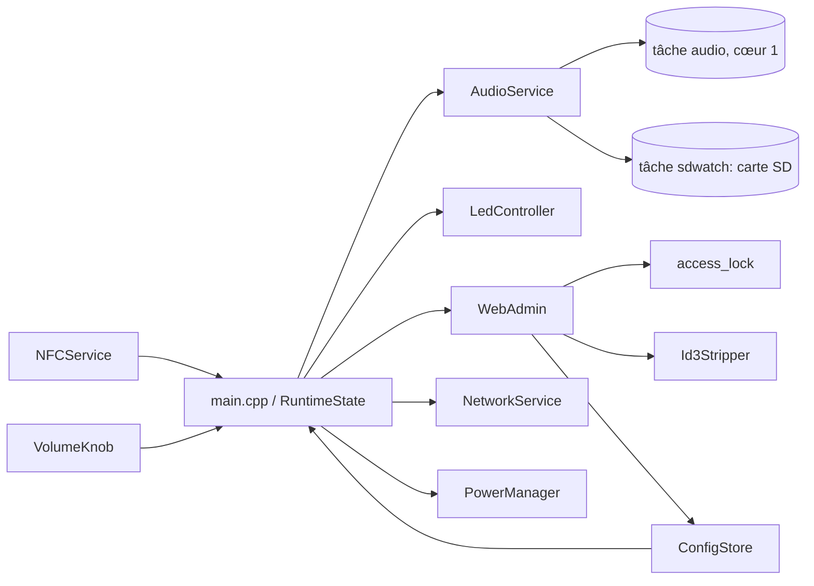

# Architecture du firmware

## Vue d'ensemble

Le firmware est organisé autour de services spécialisés, orchestrés par une boucle principale non bloquante (`loop()`, cœur 1). Le décodage audio tourne à part dans une tâche FreeRTOS plus prioritaire sur le même cœur; le cœur 0 reste à la pile Wi-Fi.

## Services

- `ConfigStore`: charge et sauvegarde en NVS la configuration (volume, Wi-Fi, verrouillage) et les associations NFC, en JSON.
- `NFCService`: détecte présence, UID et retrait de carte (PN532 en SPI matériel, bus `HSPI`), piloté par l'IRQ (GPIO21): `tick()` lance une recherche et ne lit la réponse que lorsque l'IRQ la signale, sans jamais bloquer `loop()`.
- `AudioService`: construit la playlist (fichier seul ou dossier trié), pilote ESP32-audioI2S dans une tâche dédiée protégée par mutex, gère la reprise. Une seconde tâche (`sdwatch`) monte la carte SD, la distingue absente ou illisible (exFAT) et détecte son retrait à chaud, sans jamais bloquer `loop()`.
- `LedController`: rend les états lisibles sans écran; envoie toute la bande en une trame RMT, uniquement si l'image change.
- `VolumeKnob`: lit l'encodeur rotatif et son bouton.
- `PowerManager`: veille profonde après 5 min sans interaction ni lecture; réveil par carte NFC (PN532 en recherche autonome `InAutoPoll`, antenne coupée entre deux recherches, qui baisse son IRQ sur GPIO21) ou appui sur l'encodeur (GPIO11). Une carte laissée sur la boîte est vérifiée toutes les 10 s par un réveil bref, sans démarrer la boîte.
- `NetworkService`: connexion Wi-Fi non bloquante (suivie depuis `loop()`), bascule en point d'accès après 15 s sans réponse; applique sans redémarrage les réglages réseau modifiés depuis l'interface.
- `network_names`: validation du nom réseau, des SSID et des mots de passe (testée sur ordinateur).
- `WebAdmin`: sert la page (LittleFS) et l'API JSON; une fois le réseau prêt, le portail captif (DNS) en point d'accès et l'annonce mDNS `totobox.local`.
- `access_lock`: verrouillage des réglages (cartes maîtresses, code de secours haché, limitation des essais).
- `Id3Stripper`: retire tags ID3 et pochettes des MP3 pendant l'écriture des uploads.
- `logger`: `logLine()` écrit chaque ligne d'un bloc sous mutex, sans jamais bloquer la tâche audio.

## Modèle d'exécution

- `loop()` (cœur 1): molette (crans comptés par interruption, relevés ici), NFC (une recherche toutes les 100 ms, non bloquante; retrait confirmé après 250 ms sans carte), application du volume, serveur web, LEDs.
- Tâche `audio` (cœur 1, priorité 3, au-dessus de `loop()`): appelle `Audio::loop()` environ toutes les millisecondes, enchaîne les pistes, applique la reprise.
- Cœur 0: pile Wi-Fi et réseau (priorités élevées); la tâche audio n'y est plus, une connexion Wi-Fi y coupait le son.
- Le serveur web reste actif pendant la lecture mais refuse les accès SD (`503 busy_playing`); l'espace SD est mis en cache.
- Écritures NVS différées quand elles peuvent être fréquentes (volume: 1,5 s après le dernier changement).
- Activité qui repousse la veille: lecture en cours, carte posée ou retirée, molette (rotation ou appui), toute requête web sauf `GET /api/status` et les tests de connectivité du portail captif.
- Le réveil est un redémarrage complet: les signets et réglages (NVS) sont conservés, l'état déverrouillé non. Seul l'UID d'une carte restée posée survit, en mémoire RTC.

## Etats applicatifs et LEDs

| État | LEDs |
|---|---|
| `Booting` | bleu atténué fixe |
| `Ready` | chenillard bleu aller-retour |
| `Playing` | chenillard vert, aller uniquement |
| `Paused` | jaune atténué (bindings non locaux) |
| `UnknownCard` | rouge atténué |
| `Error` | rouge clignotant |
| envoi de fichiers | la bande se remplit de cyan, en boucle |

Pendant un envoi de fichiers, le serveur web traite toute la requête d'un coup: `loop()` est suspendu (NFC compris) et seules les LEDs sont rafraîchies, depuis le rappel d'envoi; les crans de molette restent comptés par interruption et le volume suit à la fin de l'envoi. Une carte posée pendant l'envoi est lue à la fin de celui-ci.

Surimpressions temporaires (5 s): jauge blanche du volume, de la limite basse (vide) à la limite haute (pleine); bande entière blanche quand une carte maîtresse déverrouille les réglages.

## Persistance (NVS via ConfigStore)

- Configuration: limites et volume courant, Wi-Fi maison, point d'accès de secours, verrouillage (`lockEnabled`, `lockCards[]`, sel et empreinte SHA-256 du code). L'ancien format `lockCardUid` est migré automatiquement.
- Catalogue des cartes: UID, nom, `mediaPath` (fichier ou dossier), mode, `resumeTrackIndex`, `resumeMs` et `resumeByte` pour la reprise.
- `channelSecretKey`: clé privée X25519 qui déchiffre les secrets envoyés par la page (`secret_channel`).
- `setupDone`: assistant de première connexion terminé. Absent d'une ancienne configuration: déduit (Wi-Fi maison, verrouillage ou cartes = déjà configurée).
- Jamais persisté: l'état déverrouillé (verrouillé à chaque démarrage).
- Hors NVS: la partition `mfg` (mot de passe d'usine, lue seulement) et la sauvegarde des cartes `/totobox-cartes.json` sur la carte SD (même format JSON que le catalogue, faite à la demande et avant chaque remise à zéro).

## Réseau

- Connexion non bloquante: le NFC et l'audio sont utilisables dès le démarrage, le Wi-Fi se connecte en arrière-plan (`wifiMode` = `connecting` dans le statut).
- Wi-Fi maison si configuré, sinon (ou après 15 s sans réponse) point d'accès `TotoBox-XXXX` (fin de l'adresse MAC, mot de passe d'usine lu dans la partition `mfg` (`scripts/provision.py`), sinon tiré au hasard, enregistré en NVS et affiché dans la console série tant qu'il n'est pas personnalisé) avec portail captif (DNS joker et redirection des URL de test Android/iOS/Windows/Firefox).
- Nom réseau réglable (défaut `totobox`): mDNS `<nom>.local` (service `_http._tcp`) relancé aussitôt, nom DHCP à la connexion suivante.
- Réglages réseau appliqués sans redémarrage, et seulement si le Wi-Fi ou le point d'accès a changé:
  - depuis le point d'accès, la boîte essaie le Wi-Fi maison en gardant son point d'accès (AP+STA); succès: le point d'accès se coupe 60 s plus tard (`kApCloseDelayMs`), échec: elle reste en point d'accès;
  - depuis le Wi-Fi maison, elle se reconnecte au nouveau réseau, et repasse en point d'accès s'il ne répond pas en 15 s.
  - « Oublier ce réseau » efface nom et mot de passe: la boîte quitte le Wi-Fi maison (ou abandonne l'essai en cours) et reste en point d'accès seul.
- Le statut (`networkAttempt`: numéro, état, IP, erreur, décompte de coupure) permet à la page d'afficher le résultat; le numéro évite de prendre l'essai précédent pour le nouveau.

## Répartition V1 / V2

- V1: lecture locale SD, NFC, LEDs, encodeur, web admin local, verrouillage.
- V2: nouveaux bindings de type `home_assistant` sans casser les bindings `sd_local`.

## Pour aller plus loin

Les pièges rencontrés avec le matériel et les bibliothèques (PN532, ESP32-audioI2S, carte SD, mDNS, Wi-Fi) et les règles qui en découlent sont détaillés dans [AGENTS.md](../AGENTS.md).
