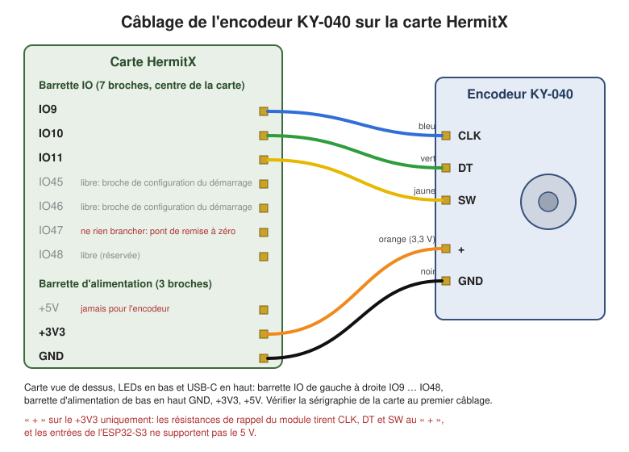

# Électronique et câblage

## Carte de base

- Module: HermitX CardReader (99 x 62 mm, modèle 3D simplifié pour Onshape dans [onshape/](onshape/README.md), référence d'achat dans la [nomenclature](README.md#nomenclature)).
- MCU: ESP32-S3.
- NFC: PN532 sur SPI dédié.
- Audio: MAX98357 en I2S.
- Stockage: microSD sur SPI principal.
- LEDs: 8 x WS2812B.

## Mapping retenu

### NFC PN532

- MISO: GPIO12
- MOSI: GPIO13
- SCK: GPIO14
- SS: GPIO15
- IRQ: GPIO21

### Audio I2S

- DOUT: GPIO40
- BCLK: GPIO41
- LRC: GPIO42

### microSD

- MOSI: GPIO17
- MISO: GPIO8
- CLK: GPIO18
- CS: GPIO5

### LEDs

- DATA: GPIO16
- 8 LEDs, bande montée à l'envers: la première LED visible est la dernière de la chaîne (`kStripReversed` dans `led_controller.cpp`).

### Encodeur KY-040 retenu

Seul périphérique à câbler: l'antenne NFC et le haut-parleur arrivent branchés sur la carte HermitX.

| Broche du KY-040 | Broche de la carte HermitX |
|---|---|
| CLK | IO9: barrette IO (7 broches), 1re broche |
| DT | IO10: barrette IO, 2e broche |
| SW | IO11: barrette IO, 3e broche |
| + | **+3V3**: barrette d'alimentation (3 broches), broche du milieu |
| GND | GND: barrette d'alimentation, broche côté LEDs |

Carte vue de dessus, LEDs en bas et USB-C en haut: la barrette IO est au centre de la carte, de gauche à droite IO9, IO10, IO11, IO45, IO46, IO47, IO48; la barrette d'alimentation est juste à droite du régulateur, de bas en haut GND, +3V3, +5V.

Le « + » va sur le **+3V3, jamais sur le +5V**: les résistances de rappel du module tirent CLK, DT et SW au « + », et les entrées de l'ESP32-S3 ne supportent pas le 5 V. Ne rien brancher sur IO47 (pont de remise à zéro d'atelier: relié à la masse au démarrage, il efface la configuration) ni sur IO45 / IO46 (broches de configuration du démarrage).

### Remise à zéro d'atelier

- GPIO47 relié à la masse au démarrage (pont ou pastilles accessibles seulement boîte démontée): la bande se remplit de rouge pendant 5 s (retirer le pont annule), la configuration est effacée, puis la bande clignote en vert jusqu'au retrait du pont et la boîte redémarre. Pull-up interne, rien à câbler en usage normal.

### GPIO libres conservés

- GPIO45, GPIO46: broches de configuration du démarrage (strapping) de l'ESP32-S3, à éviter pour une entrée tirée à la masse.
- GPIO48

## Notes d'intégration

- Le PN532 reste sur un bus SPI séparé pour éviter les conflits avec la carte SD: SPI matériel `HSPI` pour le PN532, bus `SPI` par défaut pour la SD (HermitX utilisait un SPI logiciel pour le PN532).
- L'audio utilise le port I2S 0 (valeur par défaut de la lib ESP32-audioI2S).
- Les LEDs sont pilotées par RMT, toute la bande en une seule trame (timings WS2812, tick 100 ns).
- CPU à 240 MHz pour laisser de la marge au décodage MP3 pendant que le Wi-Fi est actif.
- La V1 est alimentée en USB-C fixe; il n'y a pas de télémétrie batterie native sans ajout matériel.
- Si une jauge batterie devient nécessaire plus tard, réserver un ADC et documenter l'étage de mesure avant d'implémenter l'UI LED correspondante.
